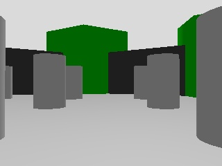

# An agent asks a model about the robot's camera and drives it by the answer

The acceptance run of [behavioralstate/spec#266](https://github.com/behavioralstate/spec/issues/266), a slice of
[behavioralstate/spec#260](https://github.com/behavioralstate/spec/issues/260): one task across two doors. An LLM
client, given only the two manifests through the published connector, signed in to best-robot's door in front of a
simulated TurtleBot3 and to a best-peer door. It deployed a vision model on the peer and read the robot's camera as an
address and a SHA-256. It asked the model, in a prompt naming that image, how far the robot could drive straight ahead.
It read the answer from `PromptAnswered` and sent the robot a `navigate-to` that far ahead, then told the person, from
both doors' events, what the model was shown, what it answered and where the robot went. The image's bytes went from
the robot's door to the peer by HTTP, never on BEST. This file records the run: how it was set up, what it showed, and
the transcript.

## The run

- **The machine**: the owner's Windows 11 laptop (an AMD Ryzen 9 6900HX, no NVIDIA card), on 2026-11-07.
- **The robot's door**: best-robot at commit 734b037, built in release, served on loopback `http://127.0.0.1:7780`
  from a fresh data folder.
  - The simulated robot is the nav2 testbed of this repository (`testbed/nav2`): headless Gazebo, a TurtleBot3, Nav2
    and rosbridge on ROS 2 Jazzy, with the waffle's camera made an RGB-D camera and its colour image republished as
    JPEG on `/camera/image/compressed`. It ran in Docker 29.9.2, started with `scripts/sim.sh`.
  - It used the testbed's configuration (`testbed/nav2/best-robot.toml`): the `navigate-to` and `spin` skills, and the
    `get-pose`, `get-odom` and `get-camera` queries; and the owner's envelope (`testbed/nav2/envelope.toml`), which
    this run never reached.
- **The model's door**: best-peer 0.0.36, the release's own `x86_64-pc-windows-msvc` binary (its zip's SHA-256 matched
  the release's `SHA256SUMS`), served on loopback `http://127.0.0.1:7777` from a fresh data folder, with:
  - `BEST_PEER_RUNTIME=native`, so it deploys to an Ollama it finds on 127.0.0.1:11434;
  - `BEST_PEER_GPU=none`, since the laptop has no NVIDIA card, so its one device was the CPU;
  - `BEST_PEER_STORE_CLEARTEXT=loopback`, so it fetches an image from the robot's door over plain http on loopback.
- **The engine**: Ollama 0.40.15 on an RTX 5090, a Windlet job (order `ff6d8ea3`, `ollama/ollama:0.40.15` with
  `serve`, port 11434) reached at its gateway address with the account's key.
  - A forwarder of a few lines on 127.0.0.1:11434, not part of either repository, added the key and passed each
    request on, so to the peer the engine was a local Ollama. Its log shows the deploy's `GET /` and `POST /api/pull`
    at 10:43:03, and one `POST /v1/chat/completions` answered at 10:45:27.
  - The model, `gemma3:4b` (3.9B parameters, Q4_K_M, with its vision encoder), was pulled onto the engine before the
    run, from 10:30 to 10:42, since the host's link is slow; the agent's deploy then found it there.
  - The job ran from 10:26:58 to 10:47:09: 1211 seconds billed, EUR 0.23.
- **The client**: Claude Code 2.1.319 on Claude Sonnet 5.5, one headless process (`claude -p` reading the person's
  turns as stream-json), in an empty folder, with the person's sentence as its first message, set up as in
  [the drive's run](drive-from-the-manifest.md):
  - its built-in tools reduced to its own tool search, slash commands and auto memory off;
  - `--strict-mcp-config`, so the published connector was its one MCP server, and `--allowedTools 'mcp__best__*'`;
  - the connector `@behavioralstate/best-mcp` 2.6.3 with no connection configured, `BEST_MCP_ALLOW_LOCAL=true`, and its
    credential file in a scratch folder, deleted afterwards.
- **Nothing written for the agent**: the person's sentence names the two manifests' addresses and the model. The agent
  read both manifests, all four catalogues, the workflows (none on either door) and three schema documents; it never
  saw either repository.
- **The person's part**: three approvals at the machine and two answers to the client.
  - The client showed a code from each door at 10:42:37. A script at the machine approved each with
    `best-robot approve` or `best-peer approve`, on that door's data folder, whichever door knew the code.
  - When the client stopped to ask about the approvals, the person answered "Approved." (10:42:44 and 10:42:51).
- **The validator**: `best-validate` 0.4.3 passed against both doors, anonymous, after the run: BEST 0.9.17,
  conformant, 0 failures each. Each has the one warning of the drive's run: the manifest has no `ETag` or
  `Cache-Control` header.



The image above is the one the model was shown: the robot door's latest camera image when the agent read it, 320 by
240 pixels, 9852 bytes, SHA-256 `6742a402cb6e7d365a2c9bcbfc6739f5f9a7c514e534115e40358890390d2303`, fetched from the
door's `/frames/` address after the run and checked against that digest.

## What the run showed

- Every step of the outcome ran on the testbed, and both doors' event logs agree with the transcript:
  - **Sign-in to both doors**: the device flow on each, with the keys kept by the connector.
  - **The model**: `deploy-model` of `gemma3:4b` with the engine `ollama` on `cpu-0`, 4.5 GB asked;
    `DeploymentReady` 0.86 s after `DeploymentStarted`, since the engine held the model.
  - **The camera**: `get-camera` answered `frame` with the image's `url`, `sha256`, `format` and size, never its
    bytes. Read at 10:42:59 and again at 10:44:39, it named the same image both times, since the robot had not moved
    and the simulated scene was still.
  - **The question**: a `prompt` to that deployment with one user turn, the question and one image named by that
    address and digest, at temperature 0. The peer fetched the image from the robot's door, checked its digest and
    showed it to the model. `PromptAnswered` came at 10:45:27, naming the image by the same address and digest,
    with 336 prompt tokens and 85 completion tokens.
  - **The answer**: "1.5", on the first line as asked, then a short explanation.
  - **The drive**: the agent read `get-pose` (x -2, y -0.5, facing along x), took 1.5 m ahead as x -0.5, y -0.5,
    and sent `navigate-to` there. Six `NavigateToProgressed` and then `NavigateToSucceeded`, 4.05 s after the first,
    with the last feedback at x -0.71, y -0.56 and 0.22 m left.
  - **The record**: the agent told the person what the model was shown, by address and digest, what it answered and
    where the robot went, reading both doors' events.
- The image's bytes were never on BEST. They appear in neither the client's log nor either door's event log: the
  peer's whole log is 3 KB and the robot's 5 KB, against a 9852-byte image, and no line holds the JPEG's base64. The
  bytes went once from the robot's door to the peer, by HTTP on loopback, and on to the engine.
- The run proves the path, not the model's judgement. The model said the green block was the nearest obstacle; in the
  image the grey pillars are nearer, and the green blocks stand behind them. Its 1.5 m took the robot
  between the first row of pillars, which Nav2 found clear. The agent said it had not looked at the image itself and
  could not check the model's reading of it.
- The sentence asked for one name, run266, on both doors, and a name in the connector names one door. The second
  sign-in took the name, and the agent saw it and signed the robot in again as run266-robot, which cost the person a
  third approval and a second answer. The robot's door holds the first approval, as run266, never collected.
- The peer, under `native`, recorded `ImagePulling` and `ImagePulled` of `ollama/ollama:0.40.6` for the deploy, though
  that runtime pulls no container image and none was pulled.
- The navigation ended 0.2 m short of its goal, as both of the drive's run did: `NavigateToSucceeded` is Nav2's goal
  tolerance. The agent said so, and that the pose query read afterwards lagged behind the last feedback.
- The agent left the deployment running, and said so; the sentence did not ask it to end it.
- 36 tool calls and two answers from the person. From the person's sentence to the agent's last answer took
  4 minutes 30 seconds, from 10:42:23 to 10:46:53.

## The transcript

This transcript is rendered from the client's own session log, as the drive's run is:
- every message in order;
- tool calls numbered with their arguments;
- each call's result under it, or under the second of two calls sent together, in the same order, shortened where
  it ran past a screen, with event lists as one line per event;
- the person's sentence and answers, which reached the client on its input and are placed where they were given.

The credentials appear only as the connector's redaction, and the scratch folder's path is masked. The tool search's
result is a set of tool definitions loaded for the model, which the log does not keep as text.

---

**The person:**

> Two BEST doors run on this machine: a robot's at http://127.0.0.1:7780/.well-known/best and one that runs AI models at http://127.0.0.1:7777/.well-known/best. Sign me in to both as run266. Run the vision model gemma3:4b on the second, show it what the robot's camera sees right now, and ask it how far the robot can drive straight ahead before it would hit something. Then drive the robot forward by what the model said, stopping short of anything it may not drive into, and follow it until it gets there. Finally, from both doors' own records, tell me what the model was shown, what it answered, and where the robot went.

1. `ToolSearch` {"query": "select:mcp__best__register_agent,mcp__best__exchange_device_code,mcp__best__get_manifest,mcp__best__list_connections,mcp__best__get_command_catalogue,mcp__best__get_command_schema,mcp__best__get_query_catalogue,mcp__best__get_query_schema,mcp__best__execute_query,mcp__best__send_command,mcp__best__send_command_and_wait,mcp__best__get_events,mcp__best__get_workflows,mcp__best__sample_event_stream,mcp__best__get_event_schema", "max_results": 20}

   ```
   (the tool search's result: the connector's tool definitions, loaded for the agent)
   ```

2. `best-register_agent` {"name": "run266", "manifest": "http://127.0.0.1:7780/.well-known/best", "agent_label": "Claude on Riccardo's machine (run266)"}

   ```
   {
     "name": "run266",
     "resolved": "http://127.0.0.1:7780/.well-known/best",
     "user_code": "SCMV-X4MC",
     "verification_uri": "http://127.0.0.1:7780/auth/verify",
     "verification_uri_complete": "http://127.0.0.1:7780/auth/verify?user_code=SCMV-X4MC",
     "expires_in": 600,
     "interval": 5,
     "next": "SHOW THE PERSON THE LINK AND THE CODE NOW, exactly as returned (verification_uri_complete already carries the code), and ask them to open it in their own browser: there they sign in — or sign up, where the service offers it — and approve you. Never open it yourself or in a browser you control: approving is theirs. Then call exchange_device_code with connection 'run266' and no device_code; while they have not acted it answers authorization_pending, which is not an error. The device code itself is held by best-mcp and is not shown."
   }
   ```

3. `best-register_agent` {"name": "run266", "manifest": "http://127.0.0.1:7777/.well-known/best", "agent_label": "Claude on Riccardo's machine (run266)"}

   ```
   {
     "name": "run266",
     "resolved": "http://127.0.0.1:7777/.well-known/best",
     "user_code": "M8PM-KHZZ",
     "verification_uri": "http://127.0.0.1:7777/auth/verify",
     "verification_uri_complete": "http://127.0.0.1:7777/auth/verify?user_code=M8PM-KHZZ",
     "expires_in": 600,
     "interval": 5,
     "next": "SHOW THE PERSON THE LINK AND THE CODE NOW, exactly as returned (verification_uri_complete already carries the code), and ask them to open it in their own browser: there they sign in — or sign up, where the service offers it — and approve you. Never open it yourself or in a browser you control: approving is theirs. Then call exchange_device_code with connection 'run266' and no device_code; while they have not acted it answers authorization_pending, which is not an error. The device code itself is held by best-mcp and is not shown."
   }
   ```

**The agent:** I started sign-in on both doors, and each needs you to approve it in your browser.

- **Robot (port 7780):** open http://127.0.0.1:7780/auth/verify?user_code=SCMV-X4MC. The code is `SCMV-X4MC`.
- **AI models (port 7777):** open http://127.0.0.1:7777/auth/verify?user_code=M8PM-KHZZ. The code is `M8PM-KHZZ`.

**Name conflict:** a connection name can point to only one door. I registered `run266` for the robot first and then for the model door. The second request resolved to port 7777, so `run266` may now point there and not at the robot.

I haven't confirmed which door `run266` points to. Please tell me which of these you want:

1. Keep `run266` for the model door and sign the robot in as `run266-robot`.
2. Keep `run266` for the robot and sign the model door in as `run266-models`.

Once you've chosen and approved the links, I'll finish the sign-ins and carry on with the camera, the model question and the drive.

**The person:**

> Approved.

4. `best-exchange_device_code` {"connection": "run266"}

   ```
   {
     "access_token": "<stored by best-mcp — never shown to the model>",
     "auth_header": "X-Api-Key",
     "endpoint": "http://127.0.0.1:7777",
     "manifest": "http://127.0.0.1:7777/.well-known/best",
     "name": "run266",
     "ready_check": "http://127.0.0.1:7777/queries",
     "token_type": "apikey",
     "session": {
       "connection": "run266",
       "connections": [
         {
           "name": "run266",
           "endpoint": "http://127.0.0.1:7777"
         }
       ],
       "signed_in_at": "http://127.0.0.1:7777/.well-known/best",
       "stored_under": "run266",
       "stored_at": "<scratch>/agent/credentials.json",
       "note": "Signed in under 'run266'. Pass connection 'run266' on every call for this service — it works now and at every later start. The key itself was not returned and must never be typed into the conversation."
     }
   }
   ```

5. `best-register_agent` {"name": "run266-robot", "manifest": "http://127.0.0.1:7780/.well-known/best", "agent_label": "Claude on Riccardo's machine (run266)"}

   ```
   {
     "name": "run266-robot",
     "resolved": "http://127.0.0.1:7780/.well-known/best",
     "user_code": "Z3LF-5MNT",
     "verification_uri": "http://127.0.0.1:7780/auth/verify",
     "verification_uri_complete": "http://127.0.0.1:7780/auth/verify?user_code=Z3LF-5MNT",
     "expires_in": 600,
     "interval": 5,
     "next": "SHOW THE PERSON THE LINK AND THE CODE NOW, exactly as returned (verification_uri_complete already carries the code), and ask them to open it in their own browser: there they sign in — or sign up, where the service offers it — and approve you. Never open it yourself or in a browser you control: approving is theirs. Then call exchange_device_code with connection 'run266-robot' and no device_code; while they have not acted it answers authorization_pending, which is not an error. The device code itself is held by best-mcp and is not shown."
   }
   ```

**The agent:** The model door is signed in as `run266`. The robot door isn't signed in yet.

The name `run266` can only point to one door, and it ended up on the model door at port 7777. Your approval of the first robot code was lost when the model door took the name. I've started a new robot sign-in under `run266-robot`, so I need one more approval from you:

- Open http://127.0.0.1:7780/auth/verify?user_code=Z3LF-5MNT. The code is `Z3LF-5MNT`.

Tell me when you've approved it. I'll then finish the sign-in and go on to the camera, the model question and the drive.

**The person:**

> Approved.

6. `best-exchange_device_code` {"connection": "run266-robot"}

   ```
   {
     "access_token": "<stored by best-mcp — never shown to the model>",
     "auth_header": "X-Api-Key",
     "endpoint": "http://127.0.0.1:7780",
     "manifest": "http://127.0.0.1:7780/.well-known/best",
     "name": "run266-robot",
     "ready_check": "http://127.0.0.1:7780/queries",
     "token_type": "apikey",
     "session": {
       "connection": "run266-robot",
       "connections": [
         {
           "name": "run266-robot",
           "endpoint": "http://127.0.0.1:7780"
         }
       ],
       "signed_in_at": "http://127.0.0.1:7780/.well-known/best",
       "stored_under": "run266-robot",
       "stored_at": "<scratch>/agent/credentials.json",
       "note": "Signed in under 'run266-robot'. Pass connection 'run266-robot' on every call for this service — it works now and at every later start. The key itself was not returned and must never be typed into the conversation."
     }
   }
   ```

7. `best-get_manifest` {"connection": "run266-robot"}

   ```
   {
     "client": "@behavioralstate/best-mcp 2.6.3",
     "manifestUrl": "http://127.0.0.1:7780/.well-known/best",
     "scope": "global",
     "manifest": {
       "best": {
         "authentication": {
           "deviceAuthorizationUrl": "http://127.0.0.1:7780/auth/device",
           "in": "header",
           "scheme": "X-Api-Key",
           "scopes": [
             "navigate-to",
             "spin"
           ],
           "tokenUrl": "http://127.0.0.1:7780/auth/token",
           "type": "apiKey"
         },
         "capabilities": [
           {
             "description": "What this peer can be asked to do; the catalogue lists each command.",
             "name": "io.best.agents.commands",
             "schema": "https://behavioralstate.io/v1/schemas/agents/commands.json",
             "service": "io.best.agents",
             "spec": "https://behavioralstate.io/specs/agents/commands",
             "status": "active",
             "version": "0.9.17"
           },
           {
             "description": "What the peer did, as it happened: every command's outcome, correlated to it.",
             "endpoints": [
               {
                 "description": "What has already happened, filterable, paged",
                 "method": "GET",
                 "path": "/events"
               },
               {
                 "description": "What happens next, as server-sent events",
                 "method": "GET",
                 "path": "/events/stream"
               }
             ],
             "name": "io.best.agents.events",
             "push": {
               "mcp": false,
               "sse": true
             },
             "schema": "https://behavioralstate.io/v1/schemas/agents/ev
   … (1456 more characters, not shown)
   ```

8. `best-get_command_catalogue` {"connection": "run266-robot", "detail": "full"}

   ```
   [
     {
       "commandType": "NavigateTo",
       "dataschema": "http://127.0.0.1:7780/commands/navigate-to/1.0",
       "description": "Drives the robot to a pose in the map frame, avoiding obstacles. When it stops short, the result's error_code says why: 204 the goal is outside the map, 206 the goal is in an obstacle, 208 no path reaches it, 203 or 205 the robot itself is off the map or blocked, 105 or 106 it could not make progress, any other 1xx or 2xx a fault in its planning or control. Its outcome is an event; cancel-skill naming this command's id ends it early.",
       "schema": "navigate-to",
       "version": "1.0"
     },
     {
       "commandType": "Spin",
       "dataschema": "http://127.0.0.1:7780/commands/spin/1.0",
       "description": "Turns the robot in place by target_yaw radians, within time_allowance; it goes nowhere, so its owner's geofence does not bound it. Its outcome is an event; cancel-skill naming this command's id ends it early.",
       "schema": "spin",
       "version": "1.0"
     },
     {
       "commandType": "CancelSkill",
       "dataschema": "http://127.0.0.1:7780/commands/cancel-skill/1.0",
       "description": "Ends a skill's run you started, named by the id of the command that started it. The run then ends with its own event, Canceled or whatever came first.",
       "schema": "cancel-skill",
       "version": "1.0"
     }
   ]
   ```

9. `best-get_query_catalogue` {"connection": "run266-robot", "detail": "full"}

   ```
   [
     {
       "dataschema": "http://127.0.0.1:7780/queries/get-pose/1.0",
       "description": "Where the robot believes it is in the map frame, and how sure it is. The latest message and when it arrived; both null until one has.",
       "schema": "get-pose",
       "version": "1.0"
     },
     {
       "dataschema": "http://127.0.0.1:7780/queries/get-camera/1.0",
       "description": "What the robot's forward camera sees, 320 by 240 pixels, about 60 degrees across, as a JPEG. The latest image and when it arrived, both null until one has. The image is named by its address and the SHA-256 of its bytes, never sent: GET the address for the bytes, or hand the address and the digest to whatever looks at the image. The door keeps the latest 8 images it named, so read it again for a newer one or once an address answers 404.",
       "schema": "get-camera",
       "version": "1.0"
     },
     {
       "dataschema": "http://127.0.0.1:7780/queries/get-odom/1.0",
       "description": "The robot's odometry: where its wheels say it went, and how fast it moves now. The latest message and when it arrived; both null until one has.",
       "schema": "get-odom",
       "version": "1.0"
     }
   ]
   ```

10. `best-get_workflows` {"connection": "run266-robot"}

11. `best-get_manifest` {"connection": "run266"}

   Calls 10 and 11 were sent together; their results follow in the same order.

   ```
   This endpoint publishes no workflows.
   ```

   ```
   {
     "client": "@behavioralstate/best-mcp 2.6.3",
     "manifestUrl": "http://127.0.0.1:7777/.well-known/best",
     "scope": "global",
     "manifest": {
       "best": {
         "authentication": {
           "deviceAuthorizationUrl": "http://127.0.0.1:7777/auth/device",
           "in": "header",
           "scheme": "X-Api-Key",
           "scopes": [
             "deploy",
             "jobs",
             "prompt",
             "workspaces",
             "metrics"
           ],
           "tokenUrl": "http://127.0.0.1:7777/auth/token",
           "type": "apiKey"
         },
         "capabilities": [
           {
             "description": "What this peer can be asked to do; the catalogue lists each command.",
             "name": "io.best.agents.commands",
             "schema": "https://behavioralstate.io/v1/schemas/agents/commands.json",
             "service": "io.best.agents",
             "spec": "https://behavioralstate.io/specs/agents/commands",
             "status": "active",
             "version": "0.9.17"
           },
           {
             "description": "What the peer did, as it happened: every command's outcome, correlated to it.",
             "endpoints": [
               {
                 "description": "What has already happened, filterable, paged",
                 "method": "GET",
                 "path": "/events"
               },
               {
                 "description": "What happens next, as server-sent events",
                 "method": "GET",
                 "path": "/events/stream"
               }
             ],
             "name": "io.best.agents.events",
             "push": {
               "mcp": false,
               "sse": true
             },
           
   … (2078 more characters, not shown)
   ```

12. `best-get_command_catalogue` {"connection": "run266", "detail": "full"}

13. `best-get_query_catalogue` {"connection": "run266", "detail": "full"}

   Calls 12 and 13 were sent together; their results follow in the same order.

   ```
   [
     {
       "commandType": "PullImage",
       "dataschema": "http://127.0.0.1:7777/commands/pull-image/1.0",
       "description": "Pulls a container image from its registry onto this peer, whether or not the peer holds it already, so a later deploy or job can start at once: how a held image is refreshed where a deploy or a job runs what the peer holds as it is. The outcome is an ImagePulled or ImagePullFailed event with this command's correlation id. Needs the deploy scope.",
       "schema": "pull-image",
       "version": "1.0"
     },
     {
       "commandType": "DeployModel",
       "dataschema": "http://127.0.0.1:7777/commands/deploy-model/1.0",
       "description": "Serves a model on this peer with the engine named, on a device that offers an API the engine runs on and has the memory asked for free. Refused at once, with the reason and what to do, when no device fits, or when the credential already runs as many deployments across this door as its approver allowed (DEPLOYMENTS_EXCEEDED); a credential held to the accelerators runs on those get-hardware-state shows it, never on a host's CPU (ACCELERATORS_ONLY). Otherwise the facts follow on the stream with this command's correlation id: ImagePulling and ImagePulled (an image the peer holds is used as it is, not pulled again, when it is pinned by digest or the operator pulls only what is missing; one named by tag is otherwise pulled each time), DeploymentStarted, WeightsLoading, then DeploymentReady, after which prompt commands naming the deployment are answered, or DeploymentFailed, which complete it; an engine that exits before its model is rea
   … (11952 more characters, not shown)
   ```

   ```
   [
     {
       "dataschema": "http://127.0.0.1:7777/queries/get-hardware-state/1.0",
       "description": "The accelerators on this host right now: each device's compute APIs with their versions, its memory total and free, temperature, power, utilisation and the energy it has used, the isolation a workload on it gets, its availability (busy while its owner is using it or holds it), and the driver. Read it before deploying: a model needs an API the device offers, memory it has free and the device free; get-workloads says what already holds memory.",
       "schema": "get-hardware-state",
       "version": "1.0"
     },
     {
       "dataschema": "http://127.0.0.1:7777/queries/get-workloads/1.0",
       "description": "What this peer runs for you now: each deployment with its model, engine, device, the memory promised to it, its phase (starting, ready, ending) and its prompts so far (answered and failed, and the tokens the engine counted for the answered ones); each job with its image, device and phase (running, stopping, or storing: it exited and its outputs are being sent); queued, the orders of this peer's queue that wait for room, oldest first; and held_bytes, the device memory your workloads hold together on this door, against share_bytes, the most your credential may hold (null when no share was set). A credential approved for all sees every holder's workloads, with the holder. The ids here are what undeploy-model and stop-job name.",
       "schema": "get-workloads",
       "version": "1.0"
     },
     {
       "dataschema": "http://127.0.0.1:7777/queries/get-workspaces/1.0",
       "description": "Who you ar
   … (756 more characters, not shown)
   ```

14. `best-get_workflows` {"connection": "run266"}

   ```
   This endpoint publishes no workflows.
   ```

15. `best-execute_query` {"connection": "run266", "schema": "get-workloads"}

   ```
   {
     "deployments": [],
     "held_bytes": 0,
     "jobs": [],
     "queued": [],
     "share_bytes": null
   }
   ```

16. `best-execute_query` {"connection": "run266", "schema": "get-hardware-state"}

   ```
   {
     "devices": [
       {
         "availability": {
           "state": "free"
         },
         "compute": [
           {
             "api": "cpu"
           }
         ],
         "energy_j": null,
         "id": "cpu-0",
         "isolation": "process",
         "memory": {
           "free_bytes": 7566389248,
           "total_bytes": 30886772736
         },
         "name": "AMD Ryzen 9 6900HX with Radeon Graphics",
         "power_w": null,
         "slicing": "none",
         "temperature_c": null,
         "utilisation_pct": 21,
         "vendor": {
           "other": "host"
         }
       }
     ],
     "driver": null,
     "observed_at": "2026-11-07T10:42:58.6565941Z"
   }
   ```

17. `best-get_command_schema` {"connection": "run266", "schema": "deploy-model", "version": "1.0"}

   ```
   {
     "$id": "http://127.0.0.1:7777/commands/deploy-model/1.0",
     "$schema": "https://json-schema.org/draft/2020-12/schema",
     "additionalProperties": false,
     "commandType": "DeployModel",
     "completes": [
       "DeploymentEnded",
       "DeploymentFailed",
       "DeploymentReady",
       "OutOfMemory"
     ],
     "description": "Serves a model on this peer with the engine named, on a device that offers an API the engine runs on and has the memory asked for free. Refused at once, with the reason and what to do, when no device fits, or when the credential already runs as many deployments across this door as its approver allowed (DEPLOYMENTS_EXCEEDED); a credential held to the accelerators runs on those get-hardware-state shows it, never on a host's CPU (ACCELERATORS_ONLY). Otherwise the facts follow on the stream with this command's correlation id: ImagePulling and ImagePulled (an image the peer holds is used as it is, not pulled again, when it is pinned by digest or the operator pulls only what is missing; one named by tag is otherwise pulled each time), DeploymentStarted, WeightsLoading, then DeploymentReady, after which prompt commands naming the deployment are answered, or DeploymentFailed, which complete it; an engine that exits before its model is ready is DeploymentFailed with its exit code and its last words. Later, OutOfMemory or DeploymentEnded if the engine ends it or stops on its own, when whoever runs this peer takes the credential back, or when its owner holds its device and ends what runs there, under the same correlation id. Needs the deploy scope, and room in the credential
   … (1717 more characters, not shown)
   ```

18. `best-get_command_schema` {"connection": "run266", "schema": "prompt", "version": "1.0"}

   ```
   {
     "$id": "http://127.0.0.1:7777/commands/prompt/1.0",
     "$schema": "https://json-schema.org/draft/2020-12/schema",
     "additionalProperties": false,
     "commandType": "Prompt",
     "completes": [
       "PromptAnswered",
       "PromptFailed"
     ],
     "description": "Asks a ready deployment on this peer to answer a conversation, whole. The messages are the conversation so far, each with its role (system, user, assistant) and content; max_tokens, temperature and stop are the engine's knobs, and are left to the engine when not given. A turn may show the model images, at most four in a prompt, each named by its address and the SHA-256 of its bytes, never sent: the peer fetches it (https, or plain http on its own loopback where its operator allows it), checks the digest, and shows it to the model when it is a JPEG or a PNG of at most 8 MiB; the outcome names them again. An image the peer cannot fetch, or whose bytes are not the ones named, is PromptFailed with the reason. Refused at once, with the reason and what to do, when the deployment is not there, not ready yet, ending, or another credential's. Otherwise PromptAnswered follows on the stream with this command's correlation id, carrying the answer and the token counts the engine reports, or PromptFailed with the reason and the fix; either completes the command. Nothing of the engine is reachable any other way: this command is the one data path. Needs the prompt scope.",
     "produces": [
       "PromptAnswered",
       "PromptFailed"
     ],
     "properties": {
       "deployment": {
         "description": "The deployment to ask, as DeploymentReady an
   … (2565 more characters, not shown)
   ```

19. `best-execute_query` {"connection": "run266-robot", "schema": "get-camera"}

   ```
   {
     "frame": {
       "bytes": 9852,
       "format": "rgb8; jpeg compressed bgr8",
       "sha256": "6742a402cb6e7d365a2c9bcbfc6739f5f9a7c514e534115e40358890390d2303",
       "url": "http://127.0.0.1:7780/frames/6742a402cb6e7d365a2c9bcbfc6739f5f9a7c514e534115e40358890390d2303"
     },
     "received_at": "2026-11-07T10:42:59.9071039Z"
   }
   ```

20. `best-execute_query` {"connection": "run266-robot", "schema": "get-pose"}

   ```
   {
     "message": {
       "header": {
         "frame_id": "map",
         "stamp": {
           "nanosec": 201000000,
           "sec": 0
         }
       },
       "pose": {
         "covariance": [
           0,
           0,
           0,
           0,
           0,
           0,
           0,
           0,
           0,
           0,
           0,
           0,
           0,
           0,
           0,
           0,
           0,
           0,
           0,
           0,
           0,
           0,
           0,
           0,
           0,
           0,
           0,
           0,
           0,
           0,
           0,
           0,
           0,
           0,
           0,
           1.0946799022804343e-13
         ],
         "pose": {
           "orientation": {
             "w": 1,
             "x": 0,
             "y": 0,
             "z": 0
           },
           "position": {
             "x": -2,
             "y": -0.5,
             "z": 0
           }
         }
       }
     },
     "received_at": "2026-11-07T10:31:03.662082Z"
   }
   ```

21. `best-get_command_schema` {"connection": "run266-robot", "schema": "navigate-to", "version": "1.0"}

   ```
   {
     "$id": "http://127.0.0.1:7780/commands/navigate-to/1.0",
     "$schema": "https://json-schema.org/draft/2020-12/schema",
     "additionalProperties": false,
     "commandType": "NavigateTo",
     "completes": [
       "NavigateToSucceeded",
       "NavigateToAborted",
       "NavigateToCanceled",
       "NavigateToRefused",
       "NavigateToStopped"
     ],
     "description": "Drives the robot to a pose in the map frame, avoiding obstacles. When it stops short, the result's error_code says why: 204 the goal is outside the map, 206 the goal is in an obstacle, 208 no path reaches it, 203 or 205 the robot itself is off the map or blocked, 105 or 106 it could not make progress, any other 1xx or 2xx a fault in its planning or control. Its outcome is an event; cancel-skill naming this command's id ends it early.",
     "produces": [
       "NavigateToProgressed",
       "NavigateToSucceeded",
       "NavigateToAborted",
       "NavigateToCanceled",
       "NavigateToRefused",
       "NavigateToStopped"
     ],
     "properties": {
       "behavior_tree": {
         "type": "string"
       },
       "pose": {
         "additionalProperties": false,
         "properties": {
           "header": {
             "additionalProperties": false,
             "properties": {
               "frame_id": {
                 "type": "string"
               },
               "stamp": {
                 "additionalProperties": false,
                 "properties": {
                   "nanosec": {
                     "maximum": 4294967295,
                     "minimum": 0,
                     "type": "integer"
                   },
                   "sec": {
                     "maximum": 2147483647,
          
   … (1292 more characters, not shown)
   ```

22. `best-send_command` {"connection": "run266", "schema": "deploy-model", "version": "1.0", "data": {"model": "gemma3:4b", "engine": "ollama", "memory_bytes": 4500000000, "device": "cpu-0"}}

   ```
   Command accepted. ID: aa426a2b-656f-4fc0-b08d-2d14fa310ced
   Correlation ID: aa426a2b-656f-4fc0-b08d-2d14fa310ced — pass it as get_events / sample_event_stream params {"correlationId": "aa426a2b-656f-4fc0-b08d-2d14fa310ced"} to observe the outcome events.
   ```

23. `best-sample_event_stream` {"connection": "run266", "params": {"correlationId": "aa426a2b-656f-4fc0-b08d-2d14fa310ced"}, "max_events": 8, "max_seconds": 90}

   ```
   0 events:
   
   {"count": 0, "lastEventId": null, "elapsedSeconds": 90, "endedBecause": "max_seconds reached", "note": "The stream is closed. Events arriving after this sample are not delivered — call again (passing lastEventId as last_event_id) to take another sample, or use get_events for history."}
   ```

**The agent:** I'm checking whether the gemma3:4b deployment on the model door has come up. The live stream showed nothing, so I'll read the event history.

24. `best-get_events` {"connection": "run266", "params": {"correlationId": "aa426a2b-656f-4fc0-b08d-2d14fa310ced"}}

   ```
   5 events:
   10:43:03.060 ImagePulling aa426a2b… {"image": "ollama/ollama:0.40.6", "progress_pct": 100}
   10:43:03.061 ImagePulled aa426a2b… {"held": false, "image": "ollama/ollama:0.40.6"}
   10:43:03.061 DeploymentStarted aa426a2b… {"container": "native-11434", "deployment": "dep-ac7b1e34c12d", "device": "cpu-0", "engine": "ollama", "holder": "2628e220270a2850", "memory_bytes": 4500000000, "model": "gemma3:4b", "port": 11434}
   10:43:03.919 WeightsLoading aa426a2b… {"deployment": "dep-ac7b1e34c12d", "model": "gemma3:4b", "progress_pct": 100}
   10:43:03.920 DeploymentReady aa426a2b… {"deployment": "dep-ac7b1e34c12d", "engine": "ollama", "model": "gemma3:4b"}
   ```

25. `best-execute_query` {"connection": "run266", "schema": "get-workloads"}

   ```
   {
     "deployments": [
       {
         "deployment": "dep-ac7b1e34c12d",
         "device": "cpu-0",
         "engine": "ollama",
         "holder": "2628e220270a2850",
         "memory_bytes": 4500000000,
         "model": "gemma3:4b",
         "peer": null,
         "phase": "ready",
         "prompts": {
           "answered": 0,
           "completion_tokens": 0,
           "failed": 0,
           "prompt_tokens": 0
         }
       }
     ],
     "held_bytes": 4500000000,
     "jobs": [],
     "queued": [],
     "share_bytes": null
   }
   ```

26. `best-execute_query` {"connection": "run266-robot", "schema": "get-camera"}

   ```
   {
     "frame": {
       "bytes": 9852,
       "format": "rgb8; jpeg compressed bgr8",
       "sha256": "6742a402cb6e7d365a2c9bcbfc6739f5f9a7c514e534115e40358890390d2303",
       "url": "http://127.0.0.1:7780/frames/6742a402cb6e7d365a2c9bcbfc6739f5f9a7c514e534115e40358890390d2303"
     },
     "received_at": "2026-11-07T10:44:39.3642915Z"
   }
   ```

27. `best-execute_query` {"connection": "run266-robot", "schema": "get-odom"}

   ```
   {
     "message": {
       "child_frame_id": "base_footprint",
       "header": {
         "frame_id": "odom",
         "stamp": {
           "nanosec": 80000000,
           "sec": 820
         }
       },
       "pose": {
         "covariance": [
           0,
           0,
           0,
           0,
           0,
           0,
           0,
           0,
           0,
           0,
           0,
           0,
           0,
           0,
           0,
           0,
           0,
           0,
           0,
           0,
           0,
           0,
           0,
           0,
           0,
           0,
           0,
           0,
           0,
           0,
           0,
           0,
           0,
           0,
           0,
           0
         ],
         "pose": {
           "orientation": {
             "w": 1,
             "x": 0,
             "y": 0,
             "z": 1.4852209586874003e-9
           },
           "position": {
             "x": 2.237190711136378e-7,
             "y": 3.3227224806437107e-16,
             "z": 0
           }
         }
       },
       "twist": {
         "covariance": [
           0,
           0,
           0,
           0,
           0,
           0,
           0,
           0,
           0,
           0,
           0,
           0,
           0,
           0,
           0,
           0,
           0,
           0,
           0,
           0,
           0,
           0,
           0,
           0,
           0,
           0,
           0,
           0,
           0,
           0,
           0,
           0,
           0,
           0,
           0,
           0
         ],
         "twist": {
           "angular": {
             "x": 0,
             "y": 0,
             "z": -2.1520146017639744e-20
           },
           "linear": {
             "x": -2.2058149668080748e-21,
             "y": 0,
             "z": 0
           }
         }
       }
     },
     "receiv
   … (39 more characters, not shown)
   ```

28. `best-send_command` {"connection": "run266", "schema": "prompt", "version": "1.0", "data": {"deployment": "dep-ac7b1e34c12d", "max_tokens": 300, "temperature": 0, "messages": [{"role": "user", "content": "This is the forward camera image of a small wheeled robot (about 60 degrees wide). Estimate how far in metres the robot can drive straight ahead before it would hit something. Give your answer as a single number of metres on the first line, then a short explanation.", "images": [{"url": "http://127.0.0.1:7780/frames/6742a402cb6e7d365a2c9bcbfc6739f5f9a7c514e534115e40358890390d2303", "sha256": "6742a402cb6e7d365a2c9bcbfc6739f5f9a7c514e534115e40358890390d2303"}]}]}}

   ```
   Command accepted. ID: 28823be7-a023-42f2-b67c-a15554e375e2
   Correlation ID: 28823be7-a023-42f2-b67c-a15554e375e2 — pass it as get_events / sample_event_stream params {"correlationId": "28823be7-a023-42f2-b67c-a15554e375e2"} to observe the outcome events.
   ```

29. `best-get_events` {"connection": "run266", "params": {"correlationId": "28823be7-a023-42f2-b67c-a15554e375e2"}}

   ```
   0 events:
   
   ```

30. `best-sample_event_stream` {"connection": "run266", "params": {"correlationId": "28823be7-a023-42f2-b67c-a15554e375e2"}, "max_events": 3, "max_seconds": 60}

31. `best-get_events` {"connection": "run266", "params": {"correlationId": "28823be7-a023-42f2-b67c-a15554e375e2"}}

   Calls 30 and 31 were sent together; their results follow in the same order.

   ```
   1 events:
   10:45:27.061 PromptAnswered 28823be7… {"completion_tokens": 85, "content": "1.5\n\nExplanation:\nThe image shows a cluttered environment with several obstacles. The robot's field of view is approximately 60 degrees.  Considering the size of the obstacles and the limited field of view, the robot can likely only drive about 1.5 meters before it would hit something. The green block is the most immediate obstacle, and the robot's view is partially obscured by it.", "deployment": "dep-ac7b1e34c12d", "finish": "stop", "images": [{"sha256": "6742a402cb6e7d365a2c9bcbfc6739f5f9a7c514e534115e40358890390d2303", "url": "http://127.0.0.1:7780/frames/6742a402cb6e7d365a2c9bcbfc6739f5f9a7c514e534115e40358890390d2303"}], "model": "gemma3:4b", "prompt_tokens": 336}
   {"count": 1, "lastEventId": "b2ee3e51-3fad-47b3-b1be-0e0209ae1852", "elapsedSeconds": 60, "endedBecause": "max_seconds reached", "note": "The stream is closed. Events arriving after this sample are not delivered — call again (passing lastEventId as last_event_id) to take another sample, or use get_events for history."}
   ```

   ```
   1 events:
   10:45:27.061 PromptAnswered 28823be7… {"completion_tokens": 85, "content": "1.5\n\nExplanation:\nThe image shows a cluttered environment with several obstacles. The robot's field of view is approximately 60 degrees.  Considering the size of the obstacles and the limited field of view, the robot can likely only drive about 1.5 meters before it would hit something. The green block is the most immediate obstacle, and the robot's view is partially obscured by it.", "deployment": "dep-ac7b1e34c12d", "finish": "stop", "images": [{"sha256": "6742a402cb6e7d365a2c9bcbfc6739f5f9a7c514e534115e40358890390d2303", "url": "http://127.0.0.1:7780/frames/6742a402cb6e7d365a2c9bcbfc6739f5f9a7c514e534115e40358890390d2303"}], "model": "gemma3:4b", "prompt_tokens": 336}
   ```

32. `best-execute_query` {"connection": "run266-robot", "schema": "get-pose"}

   ```
   {
     "message": {
       "header": {
         "frame_id": "map",
         "stamp": {
           "nanosec": 201000000,
           "sec": 0
         }
       },
       "pose": {
         "covariance": [
           0,
           0,
           0,
           0,
           0,
           0,
           0,
           0,
           0,
           0,
           0,
           0,
           0,
           0,
           0,
           0,
           0,
           0,
           0,
           0,
           0,
           0,
           0,
           0,
           0,
           0,
           0,
           0,
           0,
           0,
           0,
           0,
           0,
           0,
           0,
           1.0946799022804343e-13
         ],
         "pose": {
           "orientation": {
             "w": 1,
             "x": 0,
             "y": 0,
             "z": 0
           },
           "position": {
             "x": -2,
             "y": -0.5,
             "z": 0
           }
         }
       }
     },
     "received_at": "2026-11-07T10:31:03.662082Z"
   }
   ```

**The agent:** I'm about to drive the robot forward. The model said 1.5 m, and the robot is at (-2, -0.5) facing +x, so the goal is (-0.5, -0.5). I'll send that now and watch its events.

33. `best-send_command` {"connection": "run266-robot", "schema": "navigate-to", "version": "1.0", "data": {"pose": {"header": {"frame_id": "map"}, "pose": {"position": {"x": -0.5, "y": -0.5, "z": 0}, "orientation": {"x": 0, "y": 0, "z": 0, "w": 1}}}}}

   ```
   Command accepted. ID: 8475c3a0-caa8-46cf-a5a6-70f3c055159a
   Correlation ID: 8475c3a0-caa8-46cf-a5a6-70f3c055159a — pass it as get_events / sample_event_stream params {"correlationId": "8475c3a0-caa8-46cf-a5a6-70f3c055159a"} to observe the outcome events.
   ```

34. `best-sample_event_stream` {"connection": "run266-robot", "params": {"correlationId": "8475c3a0-caa8-46cf-a5a6-70f3c055159a"}, "max_events": 30, "max_seconds": 45}

35. `best-get_events` {"connection": "run266-robot", "params": {"correlationId": "8475c3a0-caa8-46cf-a5a6-70f3c055159a"}}

   Calls 34 and 35 were sent together; their results follow in the same order.

   ```
   5 events:
   10:45:55.741 NavigateToProgressed 8475c3a0… at x -1.52, y -0.54, 1.05 m left
   10:45:56.743 NavigateToProgressed 8475c3a0… at x -1.09, y -0.56, 0.62 m left
   10:45:57.747 NavigateToProgressed 8475c3a0… at x -0.72, y -0.56, 0.25 m left
   10:45:57.787 NavigateToProgressed 8475c3a0… at x -0.71, y -0.56, 0.22 m left
   10:45:57.787 NavigateToSucceeded 8475c3a0… {"result": {"error_code": 0, "error_msg": ""}}
   {"count": 5, "lastEventId": "459cd96f-4760-4cd8-9f16-c2f9254eccb5", "elapsedSeconds": 45, "endedBecause": "max_seconds reached", "note": "The stream is closed. Events arriving after this sample are not delivered — call again (passing lastEventId as last_event_id) to take another sample, or use get_events for history."}
   ```

   ```
   7 events:
   10:45:53.733 NavigateToProgressed 8475c3a0… at x -2.00, y -0.50, 0.00 m left
   10:45:54.741 NavigateToProgressed 8475c3a0… at x -1.82, y -0.51, 1.35 m left
   10:45:55.741 NavigateToProgressed 8475c3a0… at x -1.52, y -0.54, 1.05 m left
   10:45:56.743 NavigateToProgressed 8475c3a0… at x -1.09, y -0.56, 0.62 m left
   10:45:57.747 NavigateToProgressed 8475c3a0… at x -0.72, y -0.56, 0.25 m left
   10:45:57.787 NavigateToProgressed 8475c3a0… at x -0.71, y -0.56, 0.22 m left
   10:45:57.787 NavigateToSucceeded 8475c3a0… {"result": {"error_code": 0, "error_msg": ""}}
   ```

36. `best-execute_query` {"connection": "run266-robot", "schema": "get-pose"}

   ```
   {
     "message": {
       "header": {
         "frame_id": "map",
         "stamp": {
           "nanosec": 801000000,
           "sec": 897
         }
       },
       "pose": {
         "covariance": [
           0.03295080819088647,
           0.0025714526566509854,
           0,
           0,
           0,
           0,
           0.0025714526566509854,
           0.022904557853162644,
           0,
           0,
           0,
           0,
           0,
           0,
           0,
           0,
           0,
           0,
           0,
           0,
           0,
           0,
           0,
           0,
           0,
           0,
           0,
           0,
           0,
           0,
           0,
           0,
           0,
           0,
           0,
           0.06530618768061164
         ],
         "pose": {
           "orientation": {
             "w": 0.9999999756903805,
             "x": 0,
             "y": 0,
             "z": 0.00022049770608704062
           },
           "position": {
             "x": -0.8227401776247616,
             "y": -0.5718058068722822,
             "z": 0
           }
         }
       }
     },
     "received_at": "2026-11-07T10:45:57.376248Z"
   }
   ```

**The agent:** The robot drove forward as far as the model said, and the door reported the drive as succeeded. It finished about 0.2 m short of the goal point.

**What the model was shown**
- It was shown one forward-camera frame from the robot, taken just before I asked. The image is 320×240 and 9,852 bytes, with SHA-256 `6742a402…d2303`.
- The robot door served it at `http://127.0.0.1:7780/frames/6742a402…`. The model door's own `PromptAnswered` event lists the same address and digest.
- I didn't look at the image myself, so I can't check the model's reading of it.

**What it answered**
- I asked `gemma3:4b` (deployment `dep-ac7b1e34c12d`) how far the robot could drive straight ahead before hitting something.
- Its answer was "1.5", meaning 1.5 m. It said the scene was cluttered and that a green block was the nearest obstacle.
- The answer used 336 prompt tokens and 85 completion tokens.
- I deployed the model on the CPU, since that is the only device on the host. That deployment is still running and holds 4.5 GB.

**Where the robot went**
- It started at map position (-2.0, -0.5), facing +x.
- I sent a NavigateTo goal at (-0.5, -0.5), which is 1.5 m straight ahead.
- The progress events show it moving through x ≈ -1.82, -1.52, -1.09, then -0.71. It drifted at most about 0.06 m off the line in y.
- The last progress event put it at (-0.71, -0.56), with 0.22 m still remaining to the goal. The door then reported `NavigateToSucceeded` with error code 0 and no message.
- The door's pose query afterwards reads (-0.82, -0.57). That estimate lags behind, so I trust the progress events more.
- It travelled about 1.3 m in total. It didn't reach the exact goal, which may just be the door's goal tolerance.
- There were no recoveries and no refusals, and nothing seemed to block the drive. I didn't see any limit on where the robot may drive, so none came into play.

**Sign-ins:** the model door is `run266`, and the robot door is `run266-robot`. One name can't cover two doors, so the robot needed its own name.

